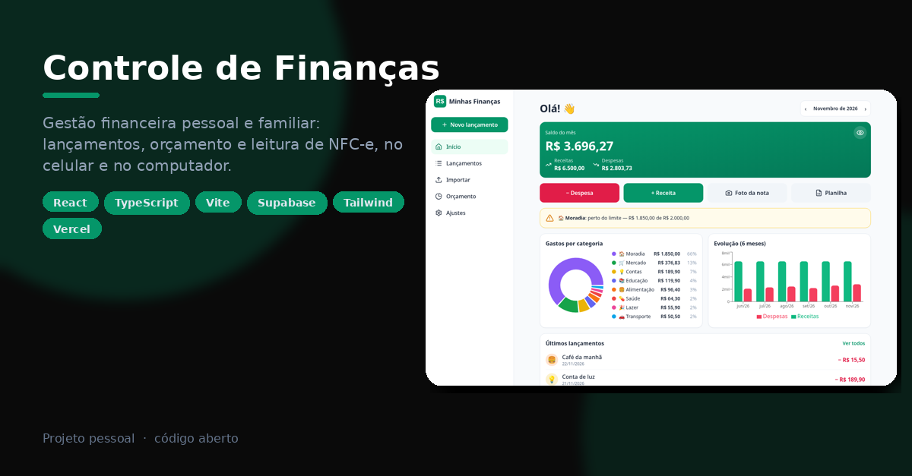
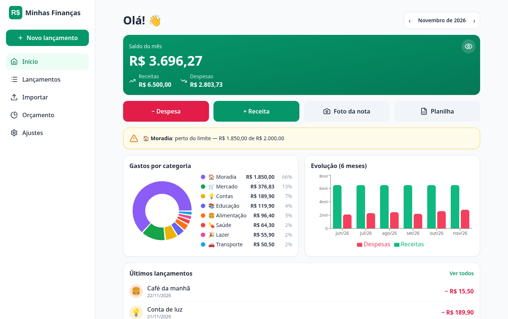
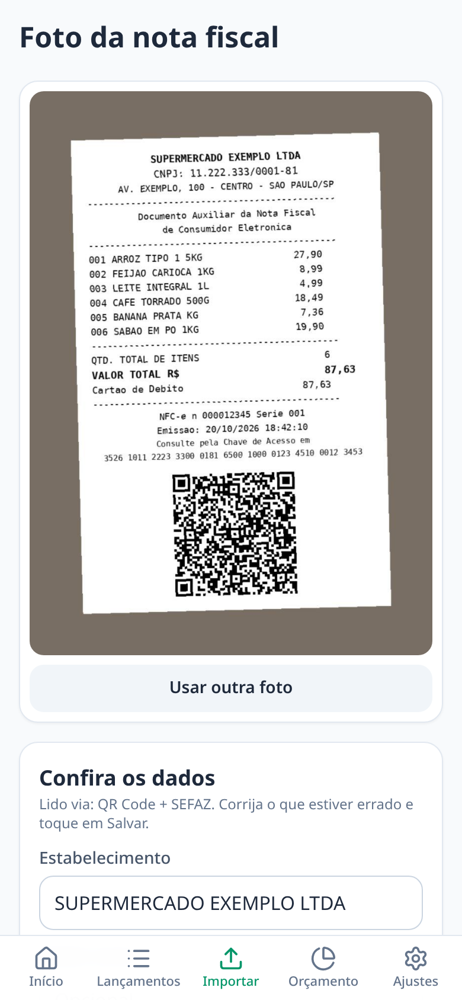
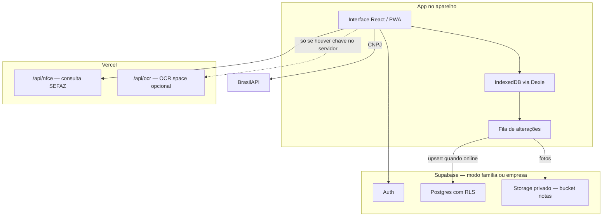

# Controle de Finanças

Projeto pessoal que comecei nas férias, pela necessidade de ter mais controle das minhas finanças — e de um app em português, com valores em **R$** e datas **dd/mm/aaaa**, que funcionasse no celular e no computador.

O código está aberto (licença MIT) para quem quiser rodar no próprio ambiente. As telas abaixo usam **dados fictícios** (Supermercado Exemplo, Padaria Pão Quente, Família Silva etc.).



| Início (desktop) | Lançamentos (celular) | Leitor de NFC-e (desktop) |
|---|---|---|
|  |  |  |

| Orçamento (desktop) | Novo lançamento | Foto da nota (celular) |
|---|---|---|
|  |  |  |

Mais telas em [`docs/screenshots/`](docs/screenshots) e em [`screenshots/`](screenshots) (importação de planilha, modo escuro e login do modo família).

## Funcionalidades

- 🏠 **Início:** saldo do mês, receitas × despesas, gráfico de gastos por categoria, evolução dos últimos 6 meses, alertas de orçamento e últimos lançamentos.
- 💸 **Lançamentos:** botões de *− Despesa* e *+ Receita*, edição e exclusão, filtro por mês, categoria e tipo, busca por texto, foto do comprovante e parcelas (até 48).
- 📂 **Categorias e contas:** ícone (emoji) e cor editáveis; contas, cartões e formas de pagamento (**Pix** e **VR - Ticket**).
- 🎫 **VR - Ticket:** cada ticket tem um titular (integrante do perfil) que identifica de quem é o saldo. Qualquer integrante pode lançar crédito (receita) ou gasto (despesa) no ticket de qualquer pessoa. O painel mostra o saldo de cada ticket; no lançamento aparece quem registrou e de quem é o ticket.
- 📊 **Orçamento** mensal por categoria, com barras de progresso e alerta ao chegar a 80% e ao estourar.
- 📥 **Importar planilha** (CSV ou Excel `.xlsx`) e **backup** em JSON (com fotos).
- 🧾 **Leitura de nota fiscal** (NFC-e): QR Code, consulta à página pública da SEFAZ, OCR no aparelho e tela de revisão antes de salvar. Também interpreta comprovantes comuns (Pix, inclusive o layout *Comprovante do Pix* / Pix Cobrança, TED, boleto, recarga, débito, maquininhas Stone/C6) e sugere a forma de pagamento (Pix, cartão, dinheiro).
- 🏷️ **Categoria automática:** sugere pela descrição (palavras-chave) e aprende com as correções.
- 👨‍👩‍👧 **Modo família** e 🏢 **modo empresa:** contas próprias, perfil compartilhado, convite, papéis de administrador e membro (detalhes abaixo).
- 📴 **Modo local:** funciona só no aparelho, sem conta e sem configurar nuvem.
- 🔐 **Segurança:** trava com biometria neste aparelho (WebAuthn) e, no modo nuvem, Row Level Security no banco e bucket privado das fotos.
- 🌙 **Tema** claro, escuro ou automático; menu inferior no celular e lateral no computador. Instalável como **PWA**.

## Modo local

Não precisa de Supabase nem de login. Os dados ficam só **neste aparelho**, no IndexedDB (Dexie). Cada navegador/aparelho tem a própria cópia.

- Use *Ajustes → Baixar backup* para gerar um arquivo JSON (inclui as fotos) e *Restaurar backup* para trazer os dados de volta ou passar para outro aparelho.
- Limpar os dados do site no navegador apaga tudo. Faça backups.
- A internet só entra na leitura de nota (consulta SEFAZ, OCR de fallback e, se houver, BrasilAPI para CNPJ).

Para usar o **mesmo** conjunto de dados no celular e no computador de forma contínua, ative o modo família (ou empresa) e faça login — ou troque backups entre os aparelhos.

## Modo família

Com um projeto gratuito no [Supabase](https://supabase.com), cada pessoa cria a **própria conta** (e-mail e senha) e entra em um **perfil compartilhado** (a “família”). No banco a tabela continua se chamando `familias`; cada linha é um perfil. A mesma pessoa pode participar de **vários perfis** — por exemplo a casa e a empresa — e troca entre eles no app. Os dados de um perfil não se misturam com os de outro (categoria ou conta de um perfil não pode ser usada em lançamento de outro).

### Convite

Quem **cria o perfil** vira **administrador**. Em *Família* o admin vê o **código de convite de 8 caracteres** (gerado no banco), pode **copiar o código**, gerar um **código novo** (o antigo deixa de valer) e tocar em **Enviar link**.

O link tem o formato `?convite=CODIGO`. No celular, *Enviar link* abre o compartilhamento do sistema (a folha nativa, que costuma incluir o WhatsApp). Quem recebe o link (ou digita o código) cria a conta e entra como **membro**.

### Papéis

- **Administrador:** vê e edita tudo do perfil (incluindo lançamentos das outras pessoas); edita categorias, contas e orçamento; gera novo código; promove, rebaixa e remove pessoas; renomeia o perfil.
- **Membro:** vê tudo do perfil e cria lançamentos; só altera ou apaga **os próprios**. Se tentar criar categoria/conta/orçamento, o servidor recusa e o app desfaz a alteração local.

O autor de cada lançamento é sempre quem está logado (`user_id` forçado no banco).

### Filtros e “Quem gastou no mês”

Com duas ou mais pessoas no perfil, a tela inicial e Lançamentos mostram o filtro **Todos / por pessoa**. No Início aparece o cartão **“Quem gastou no mês”**, com o total de cada membro; tocar no nome aplica o mesmo filtro.

### Migração dos dados locais

Se a pessoa já usava o app no aparelho (modo local), no **primeiro login** o app pergunta se quer **enviar esses lançamentos para o perfil**. Eles ficam registrados como dela. Se recusar, os dados que estavam só neste aparelho são apagados (há confirmação antes).

### Sincronização offline e conflito

Sem internet o app continua funcionando: as alterações entram numa **fila no IndexedDB** e sobem quando a conexão volta. O canto da tela indica se está tudo salvo na nuvem ou quantas alterações ainda estão na fila.

Regras de conflito, como o código faz:

- Ao enviar, o app faz *upsert* no servidor. Se duas pessoas editarem **o mesmo** lançamento offline, **vale a última gravação que chegar na nuvem**.
- Enquanto uma alteração local ainda não foi enviada, o app **não a sobrescreve** com o que baixar da nuvem.
- Alterações recusadas (por exemplo, membro tentando editar o que não é dele) são **descartadas** e o dado volta ao que está na nuvem.
- Lançamentos apagados são marcados como `excluido` no banco (não somem fisicamente).
- Sair da conta apaga a **cópia local** deste aparelho (os dados continuam na nuvem). Se houver itens ainda não enviados, o app avisa antes.

## Modo empresa

O modo empresa **não é um sistema paralelo**: é o mesmo modelo de perfil, convite, papéis (administrador e membro), filtros, migração e sincronização descritos acima. A diferença está no **tipo** do perfil e no que é pré-carregado.

- Ao criar um perfil, a pessoa escolhe **Pessoal / família** ou **Empresa**.
- No tipo empresa, o **CNPJ é opcional**. Se informado, o app pode consultar a [BrasilAPI](https://brasilapi.com.br) no cadastro para preencher a razão social (e sugerir o nome do perfil). CNPJ e razão social aparecem na tela do perfil.
- Os dados da empresa ficam em um perfil **separado** da casa: categorias, contas e lançamentos não se misturam. Sócios ou a equipe entram no mesmo perfil, cada um com a própria conta, e lançam juntos — com o mesmo filtro por pessoa e o cartão “Quem gastou no mês”.
- **Categorias e contas iniciais são diferentes.** Empresa já vem com Fornecedores, Impostos, Pró-labore e salários, Aluguel e condomínio, Software e serviços, Marketing, Tarifas bancárias, Transporte, Material e equipamentos, Vendas e serviços, etc., e com Conta PJ, Cartão PJ e Caixa. O perfil pessoal/família vem com Mercado, Alimentação, Moradia, Salário, etc., e Conta corrente, Cartão de crédito e Dinheiro.
- Ícone 🏢 no seletor de perfis (o perfil pessoal usa 👨‍👩‍👧).
- As políticas de segurança (RLS) e os papéis admin/membro são **os mesmos**. Não há um conjunto extra de permissões só para empresa.

## Leitura de nota fiscal

O fluxo, na ordem em que o app tenta:

1. **QR Code da NFC-e** (jsQR): o app lê o código na foto, extrai o link da SEFAZ e a **chave de acesso** (44 dígitos).
2. **Consulta à página pública da SEFAZ** pela function serverless `/api/nfce`, com **allowlist de hosts** (domínios `sefaz.*.gov.br` e afins) para evitar SSRF: rejeita IP direto, porta fora do padrão e redirecionamento para host não permitido. São Paulo tem parser específico; outros UFs na allowlist entram sob demanda. Preenche valor a pagar, data/hora, CNPJ, pagamento e itens.
3. Se a SEFAZ falhar (captcha, fora do ar, UF ainda sem parser), faz **OCR no aparelho** (tesseract.js, com detecção de rotação). Se ainda faltar total ou data e a variável `OCR_SPACE_API_KEY` estiver configurada no servidor, tenta o fallback opcional **OCR.space** via `/api/ocr`. Sem essa chave, o app **não** chama OCR.space.
4. Consulta o CNPJ na **BrasilAPI** (gratuita) para nome, endereço e CNAE, com cache local. Sem internet ou se a API falhar, esses campos ficam para preencher na revisão.
5. **Sugere a categoria** e abre a **tela de revisão**. Nada é lançado automaticamente: a pessoa confere e só então salva. Dá para marcar como **parcelado** (2 a 48 parcelas).

Também há leitores de comprovantes comuns (Pix, TED, boleto, recarga, débito, Stone, Pix C6). No layout **Comprovante do Pix** (Pix Cobrança: *Valor pago*, *Para*), o app usa o valor pago e o recebedor, e ignora *Valor original* e *Vencimento*. Ao importar, sugere a forma de pagamento correspondente (Pix, cartão ou dinheiro). NF-e em papel A4 (DANFE) e cupons SAT antigos entram só pelo OCR. Sempre há revisão antes de salvar.

## Segurança

### Biometria (trava neste aparelho)

Em *Ajustes → Segurança* existe a opção **Entrar com biometria** (“digital ou rosto deste aparelho para abrir o app”). Só aparece se o navegador estiver em contexto seguro (HTTPS) e oferecer autenticador de plataforma (WebAuthn / `PublicKeyCredential`).

Como funciona, de acordo com o código:

- Ao ativar, o app **cadastra uma credencial WebAuthn neste aparelho** (`navigator.credentials.create`, autenticador de plataforma, verificação do usuário obrigatória) e guarda o identificador da credencial no `localStorage`. Não é login sem senha na nuvem e não sincroniza a chave entre aparelhos: é uma **trava local**.
- A sessão do Supabase **continua no aparelho**. A biometria só **libera a tela**.
- Ao **abrir o app** ou **voltar depois de 2 minutos** em segundo plano, se a biometria estiver ligada, aparece a tela de bloqueio. O botão *Desbloquear com biometria* pede digital ou rosto; também dá para *Entrar com senha*.
- Se a biometria passar mas a sessão no servidor tiver expirado, o app pede a **senha uma vez**; depois a biometria volta a valer.
- Se a biometria **não** estiver ligada, ao abrir o app (ou voltar depois de 2 minutos fora) a sessão **neste aparelho** é encerrada e é preciso entrar de novo com e-mail e senha. Alterações ainda não enviadas ficam guardadas e sobem no próximo login.
- Links de recuperação de senha ou retorno de login não pedem a biometria de novo nessa abertura.

### Banco e fotos (modo família / empresa)

As regras ficam **no Postgres** (Row Level Security): só quem é membro do perfil lê os dados daquele perfil. Fotos de notas vão para o bucket privado `notas` (pasta = id do perfil); membro envia e vê as do perfil, e só o dono ou um administrador atualiza/apaga o arquivo.

## Importação, exportação e orçamento

- **Planilha:** CSV ou Excel (`.xlsx`). A pessoa escolhe as colunas (data, descrição, valor, categoria), confere a prévia e confirma. Reconhece `1.234,56`, `-50,00`, `(12,30)`, datas `dd/mm/aaaa` e datas do Excel. Linhas que parecem repetidas vêm desmarcadas. Há arquivos de exemplo em [`exemplos/`](exemplos) (dados fictícios).
- **Backup JSON:** baixar e restaurar, inclusive fotos. Restaurar como **membro** pode recusar itens que só o administrador cria (categorias e contas).
- **Orçamento:** limite mensal por categoria (só o administrador altera no modo nuvem). Barras de progresso; alerta no Início e na tela de orçamento ao chegar a **80%** e ao **estourar**.
- **Parcelas:** no lançamento e na revisão da nota, o valor pode ser dividido em 2 a 48 parcelas mensais.


## VR - Ticket

O **VR - Ticket** é, ao mesmo tempo, uma **categoria de receita** (o crédito que entra no ticket) e uma **forma de pagamento** (o gasto que sai do saldo).

- Um **administrador** cria a conta em *Ajustes → Contas e formas de pagamento → Nova*, escolhe o tipo **VR - Ticket** e indica **de quem é o ticket**. O app **não** cria essas contas automaticamente.
- **Qualquer integrante** do perfil pode lançar receita ou despesa em **qualquer** ticket, inclusive no de outra pessoa. O titular só identifica de quem é o saldo; não restringe quem pode usar.
- No lançamento, a lista e o filtro por pessoa separam as duas informações: **quem lançou** e **de quem é o ticket** (por exemplo, “Lançado por Alex · Ticket de Maria”). O filtro inclui o que a pessoa lançou e o que mexeu no ticket dela.
- Ao registrar uma receita nova no VR, o app sugere a categoria **VR - Ticket** se outra ainda não tiver sido escolhida.
- No Início aparece o cartão **Saldo VR - Ticket**, com o saldo restante de cada titular (receitas menos despesas daquela conta).

No banco, a coluna `titular_id` só é permitida em contas do tipo `vr_ticket`. As políticas de segurança (RLS) continuam as mesmas: o `user_id` do lançamento é quem registrou.

## Novidades

### v1.2.0 (27/11/2026)

- Card fixo de **saldo total** no Início (todas as receitas menos todas as despesas), acima do seletor de mês, separado da seção mensal.
- Um único olho, no card de saldo total, mostra ou esconde todos os valores da tela. A escolha vale nesta aba; ao abrir o app ou trocar de perfil, volta a esconder.
- O total respeita o perfil e o filtro por pessoa (incluindo o VR - Ticket) e não muda ao trocar o mês.

### v1.1.0 (27/11/2026)

- Forma de pagamento **Pix**, incluída nas contas padrão (novos perfis e modo local) e sugerida ao importar um comprovante Pix.
- Leitor de comprovante no layout **Comprovante do Pix** (Pix Cobrança): lê *Valor pago* e *Para*, e não usa *Valor original* nem a data de *Vencimento*.
- **VR - Ticket**, com titular por integrante, uso por qualquer membro do perfil, rótulo “quem lançou / de quem é o ticket” e saldo no painel.
- Migrações `20261125203000_conta_pix.sql` e `20261126160000_vr_ticket.sql` (adicione-as na ordem, se o projeto Supabase já existia).

### v1.0.0 (22/11/2026)

Versão pública inicial (MIT), já com modo local e família/empresa, leitor de NFC-e e comprovantes Stone/C6, orçamento, importação de planilha e biometria.

## Arquitetura



No modo local, Auth, Postgres e Storage não entram no caminho: tudo permanece no IndexedDB.

## Stack

React 19, TypeScript, Vite, Tailwind CSS, Dexie (IndexedDB), Supabase (Auth, Postgres com RLS, Storage), Recharts, SheetJS (`xlsx`), tesseract.js, jsQR, vite-plugin-pwa, Vercel Functions (`/api/nfce`, `/api/ocr`) e BrasilAPI (CNPJ). Testes com o runner `tsx --test` (não é Vitest), scripts e2e em Puppeteer e SQL de RLS.

## Como rodar

Precisa do [Node.js](https://nodejs.org) 20 ou superior.

```bash
cp .env.example .env   # opcional: preencha para ativar o modo família / empresa
npm install
npm run dev        # http://localhost:5173
npm run build      # gera dist/
npm run preview    # serve a versão final em http://localhost:4173
npm test           # leitor de notas e comprovantes
```

Sem `VITE_SUPABASE_URL` e `VITE_SUPABASE_ANON_KEY`, o app sobe só no **modo local**.

### Instalar no celular

Publique o app (veja *Vercel* abaixo) e abra o link no aparelho:

- **Android (Chrome):** menu ⋮ → **Instalar app** (ou "Adicionar à tela inicial").
- **iPhone (Safari):** Compartilhar → **Adicionar à Tela de Início**.

### Modo família ou empresa (Supabase), uma vez só

1. Crie um projeto em [supabase.com](https://supabase.com) (região **South America (São Paulo)** é uma boa escolha). Guarde a senha do banco.
2. **SQL Editor:** rode, **na ordem**, todos os arquivos de [`supabase/migrations/`](supabase/migrations). Pode rodar de novo.
3. **Project Settings → API:** copie a **Project URL** e a chave **anon** / publishable (`eyJ…` ou `sb_publishable_…`). **Nunca** coloque a `service_role` no app.
4. No computador, preencha o `.env`. Na **Vercel:** *Settings → Environment Variables* com `VITE_SUPABASE_URL` e `VITE_SUPABASE_ANON_KEY`, depois *Redeploy*.
5. **Authentication → URL Configuration:** *Site URL* = endereço do app; em *Redirect URLs*, o mesmo endereço com `/**` (e `http://localhost:5173/**` para desenvolvimento). Assim os links de confirmação e de recuperar senha voltam para o app.
6. **Confirmação de e-mail:** o padrão do Supabase exige clicar no e-mail. Num grupo pequeno, pode desligar em *Authentication → Providers → Email*. O e-mail grátis tem limite por hora; para muitos cadastros, configure um SMTP próprio.
7. Abra o app, crie a conta, crie o perfil (família ou empresa) e convide as outras pessoas.

### Vercel

1. [vercel.com](https://vercel.com) → *Add New → Project* → importe este repositório. A Vercel detecta **Vite** (`npm run build`, pasta `dist`).
2. Para o modo nuvem, cadastre as variáveis do passo 4 acima.
3. A function `/api/nfce` **não precisa de chave**: consulta portais públicos da SEFAZ (allowlist `.gov.br`).
4. **OCR.space é opcional** e vem desligado. Só ative se quiser um reforço quando o Tesseract falhar: chave free em [ocr.space/ocrapi](https://ocr.space/ocrapi), variável `OCR_SPACE_API_KEY` (sem prefixo `VITE_`) e Redeploy. Sem ela, o caminho continua SEFAZ + Tesseract no aparelho.

A cada `git push` o site atualiza. Em hospedagem só-estática (GitHub Pages etc.) as rotas `/api/*` não existem — o app cai no OCR local.

## Testes

```bash
npm test                 # tests/*.test.ts — comprovantes e parser de NFC-e (tsx --test)
```

Há um ambiente de Supabase de teste **sem Docker** (Postgres 15+, GoTrue e PostgREST locais; Storage emulado por `scripts/supabase-local.mjs`):

```bash
# aplique as migrações no banco de teste, na ordem de supabase/migrations/
psql -f supabase/tests/rls_test.sql
npm run supabase:local
VITE_SUPABASE_URL=http://localhost:54321 VITE_SUPABASE_ANON_KEY=$(node scripts/supabase-local.mjs --anon) npm run test:api
npm run build && npx vite preview --port 4174 &
npm run test:e2e-familia    # duas pessoas, convite, migração e permissões
```

Também dá para rodar `supabase/tests/rls_test.sql` no SQL Editor de um projeto de **teste** (ele executa dentro de uma transação e desfaz no final).

## Limitações

- **OCR não é perfeito.** Foto tremida, torta ou escura pode sair com erro — por isso sempre há tela de revisão. Com QR legível, a consulta SEFAZ costuma ser a fonte mais confiável.
- O QR “online” da NFC-e **não embute** total e data no próprio código; o app usa o link para buscar a página pública. SP tem parser pronto; outros UFs dependem da allowlist e de parser.
- A consulta de CNPJ depende da BrasilAPI e de internet.
- Biometria é **por aparelho** e precisa de HTTPS e de um navegador com autenticador de plataforma. Não substitui a conta no Supabase e não acompanha a pessoa em outro dispositivo.
- Modo local: os dados moram no navegador.
- Sincronização: última gravação na nuvem vence quando duas pessoas editam o mesmo item offline.

## Licença

[MIT](LICENSE)
