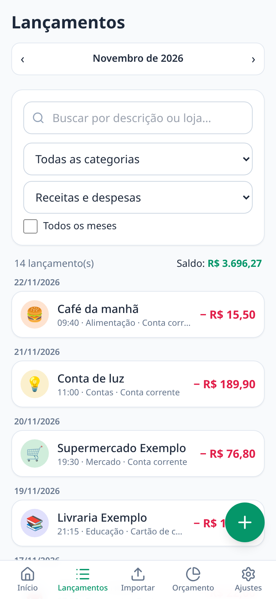
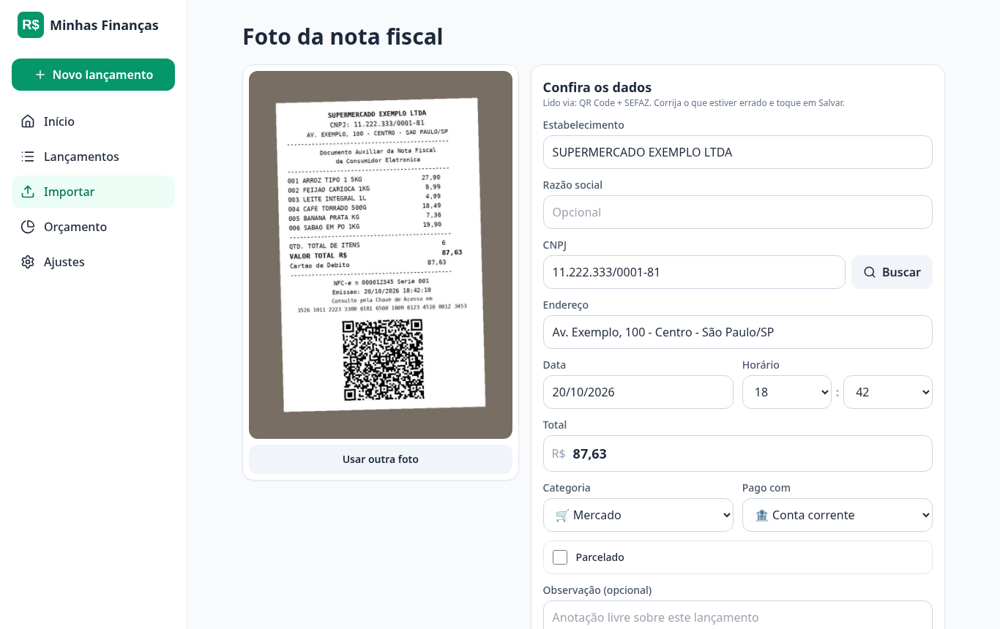
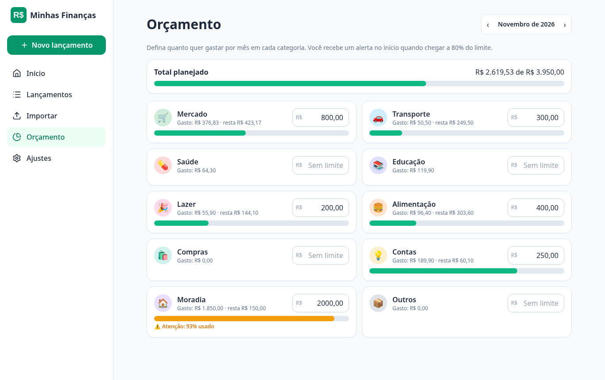
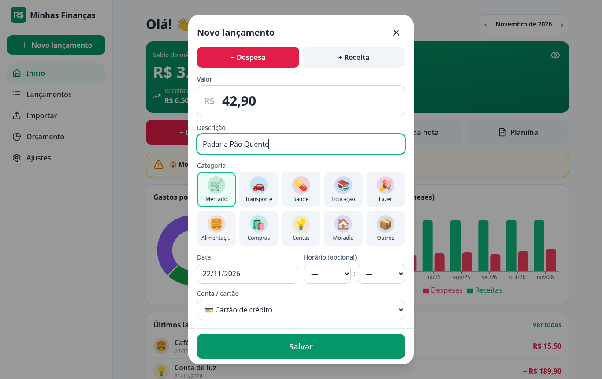
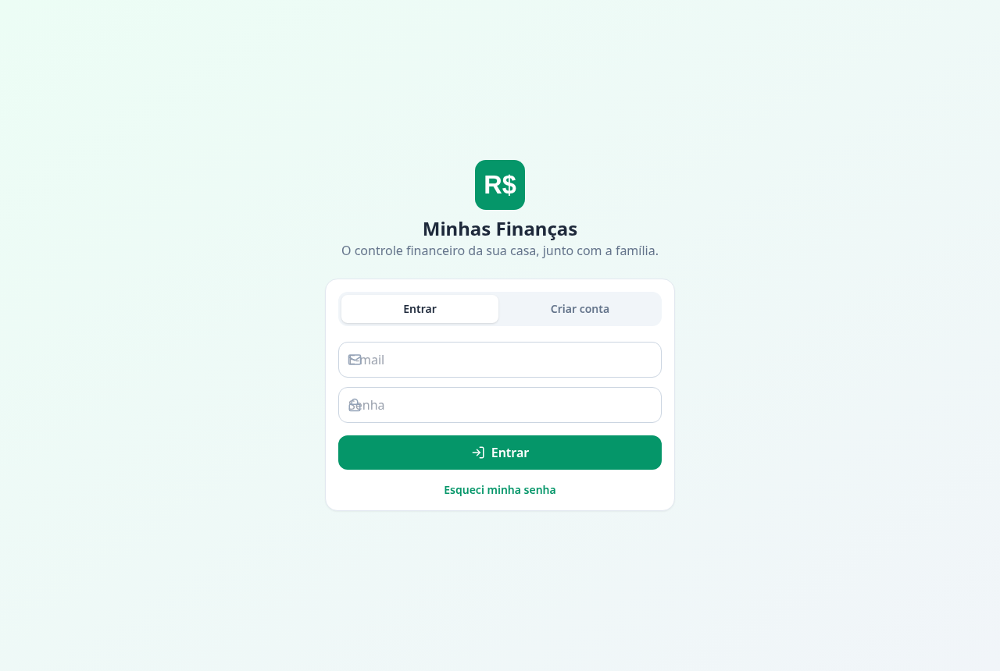
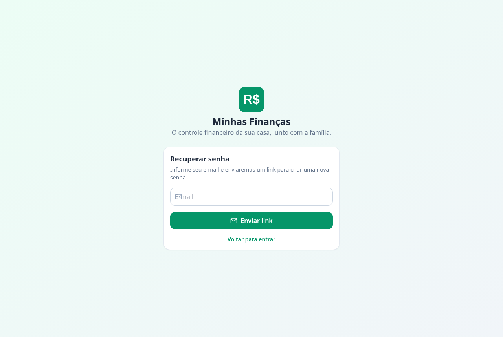

# Controle de Finanças

App de **gestão financeira pessoal e familiar**, em português, com valores em **R$** e datas **dd/mm/aaaa**. Funciona no **celular** (instalável como PWA) e no **computador**.

O app funciona de dois jeitos:

- **Modo família (nuvem):** com um projeto gratuito no [Supabase](https://supabase.com), cada pessoa tem a **própria conta** e todos veem os dados do **perfil** (uma família, ou uma empresa). Cada lançamento guarda **quem lançou**, e dá para filtrar por pessoa ou ver o perfil todo. Continua funcionando **offline** e sincroniza quando a internet volta.
- **Modo local:** sem configurar nada, os dados ficam só **no próprio aparelho** (IndexedDB), sem login. Faça **backup** em *Ajustes → Baixar backup*.

As telas abaixo usam **dados fictícios** (Supermercado Exemplo, Padaria Pão Quente, Família Silva etc.).


| Início (desktop) | Lançamentos (celular) | Leitor de NFC-e (desktop) |
|---|---|---|
|  |  |  |

| Orçamento (desktop) | Novo lançamento | Foto da nota (celular) |
|---|---|---|
|  |  |  |

Mais telas em [`docs/screenshots/`](docs/screenshots) e em [`screenshots/`](screenshots) (importação de planilha, modo escuro e login do modo família).

## Funções

- **Início:** saldo do mês, receitas × despesas, gráfico de gastos por categoria, evolução dos últimos 6 meses, alertas de orçamento e últimos lançamentos.
- **Lançamentos:** botões grandes de *− Despesa* e *+ Receita*, editar e excluir, filtro por mês, categoria e tipo, busca por texto e foto do comprovante anexada.
- **Categorias** com ícone (emoji) e cor editáveis, mais **contas e cartões**.
- **Orçamento** mensal por categoria, com barras de progresso e alertas ao chegar a 80% e ao estourar.
- **Importar planilha** (CSV ou Excel `.xlsx`): você escolhe as colunas (data, descrição, valor, categoria), confere a prévia e confirma. Reconhece `1.234,56`, `-50,00`, `(12,30)`, datas `dd/mm/aaaa` e datas do Excel. Linhas repetidas vêm desmarcadas.
- **Foto da nota fiscal** (NFC-e ou cupom):
  1. lê o **QR Code** da NFC-e (jsQR) e pega o link da SEFAZ e a **chave de acesso** (44 dígitos);
  2. consulta a **página pública da SEFAZ** via function `/api/nfce` (allowlist anti-SSRF; SP primeiro) e preenche valor a pagar, data/hora, CNPJ, pagamento e itens;
  3. se a SEFAZ falhar (captcha/fora do ar), faz **OCR** no aparelho (tesseract.js, com detecção de rotação) e, se ainda faltar total/data, tenta o fallback opcional **OCR.space** via `/api/ocr`;
  4. consulta o CNPJ na **[BrasilAPI](https://brasilapi.com.br)** (gratuita) para nome/endereço/CNAE (cache local);
  5. **sugere a categoria** e mostra a **tela de revisão** antes de salvar.
- Também interpreta comprovantes comuns (Pix, TED, boleto, recarga, débito, maquininhas Stone/C6).
- **Categoria automática:** o app sugere a categoria pela descrição (palavras-chave como "uber", "drogaria", "ifood"…) e **aprende com as correções**.
- **Modo claro/escuro/automático**, menu inferior no celular e lateral no computador.
- **Backup** em arquivo JSON (com fotos), para restaurar ou passar para outro aparelho.
- **Perfis:** além do perfil pessoal/familiar, dá para criar um perfil **empresa** (CNPJ opcional).

## Como rodar no computador

Precisa do [Node.js](https://nodejs.org) 20 ou superior.

```bash
cp .env.example .env   # opcional: preencha para ativar o modo família
npm install
npm run dev        # abre em http://localhost:5173
npm run build      # gera a versão final em dist/
npm run preview    # serve a versão final em http://localhost:4173
npm test           # testes do leitor de notas e comprovantes
```

Arquivos de exemplo estão em [`exemplos/`](exemplos): `extrato-exemplo.csv`, `nota-exemplo.jpg` (com QR Code) e `nota-sem-qrcode.jpg`. São dados **fictícios**.

Para gerar de novo as imagens de exemplo: `python3 exemplos/gerar.py` (precisa de Pillow e qrcode).

## Como instalar no celular

Primeiro publique o app (veja *Vercel* abaixo) e abra o link no celular:

- **Android (Chrome):** menu ⋮ → **Instalar app** (ou "Adicionar à tela inicial").
- **iPhone (Safari):** botão Compartilhar → **Adicionar à Tela de Início**.

O ícone aparece como um app normal e funciona sem internet. A internet só é usada na primeira leitura de nota (para baixar o leitor de texto, ~2 MB) e na consulta do CNPJ.

> Cada aparelho, no modo local, tem seus próprios dados. Para usar no celular e no computador com os mesmos dados, use *Ajustes → Baixar backup* em um e *Restaurar backup* no outro — ou ative o modo família.

## Modo família (Supabase)

| Entrar | Recuperar senha |
|---|---|
|  |  |

### Como funciona

- Quem **cria o perfil** (família ou empresa) vira **administrador**. Em **Família** ele vê o **código de convite** (ou toca em **Enviar link**) e manda pelo WhatsApp.
- Quem recebe abre o link, **cria a conta** e entra direto como **membro**.
- **Administrador:** vê e edita tudo, edita categorias, contas e orçamento, gera novo código, promove/rebaixa e remove pessoas, renomeia o perfil.
- **Membro:** vê tudo do perfil, cria lançamentos, e só altera ou apaga **os próprios**.
- Na tela inicial e em Lançamentos há o filtro **Família toda / pessoa…**, e o cartão **"Quem gastou no mês"**.
- Se a pessoa já usava o app no aparelho (modo local), no 1º login o app pergunta se quer **enviar esses dados para o perfil**.
- Sem internet tudo continua funcionando. O canto da tela mostra *"Tudo salvo na nuvem"* ou quantas alterações estão esperando.
- As regras de segurança ficam **no banco** (Row Level Security): ninguém de outro perfil consegue ler nada, nem fotos de notas (bucket privado).

### Passo a passo (uma vez só, ~10 minutos)

1. Crie uma conta em [supabase.com](https://supabase.com) → **New project**. Escolha um nome, uma senha do banco (guarde) e a região **South America (São Paulo)**.
2. No projeto, abra **SQL Editor → New query** e rode, **na ordem**, todos os arquivos de [`supabase/migrations/`](supabase/migrations). Deve aparecer *Success*. (Pode rodar de novo sem problema.)
3. Abra **Project Settings → API** (ou *Data API*) e copie:
   - **Project URL** (ex.: `https://SEU-PROJETO.supabase.co`)
   - **anon public key** (chave longa que começa com `eyJ…`, ou a *publishable key* `sb_publishable_…`). **Nunca** use a `service_role`/secret key no app.
4. Na **Vercel:** projeto → **Settings → Environment Variables** e crie:
   - `VITE_SUPABASE_URL` = Project URL
   - `VITE_SUPABASE_ANON_KEY` = anon key
   Depois vá em **Deployments → ⋯ → Redeploy**. (No computador, copie `.env.example` para `.env` e preencha. O `.env` não vai para o GitHub.)
5. No Supabase, **Authentication → URL Configuration**:
   - **Site URL:** o endereço do app (ex.: `https://seu-app.vercel.app`)
   - **Redirect URLs:** adicione `https://seu-app.vercel.app/**` (e `http://localhost:5173/**` se for usar no computador).
   Isso faz o link de **recuperar senha** e de **confirmação de e-mail** voltarem para o app.
6. **Confirmação de e-mail:** por padrão o Supabase exige que a pessoa clique no e-mail antes de entrar. Para um grupo pequeno pode ser mais prático desligar em **Authentication → Sign In / Providers → Email → Confirm email**. O e-mail grátis do Supabase tem limite baixo por hora; para muitos cadastros configure um SMTP próprio.
7. Abra o app, crie sua conta, crie o perfil (família ou empresa) e convide as outras pessoas.

### Testes (para desenvolvedores)

Há um "Supabase de teste" que roda sem Docker (Postgres 15+, [GoTrue](https://github.com/supabase/auth) e [PostgREST](https://postgrest.org) instalados localmente; o Storage é emulado por `scripts/supabase-local.mjs`):

```bash
# aplique as migrações no banco de teste, na ordem de supabase/migrations/
psql -f supabase/tests/rls_test.sql                       # verificações de RLS
npm run supabase:local                                    # gateway em :54321 (auth/rest/storage)
VITE_SUPABASE_URL=http://localhost:54321 VITE_SUPABASE_ANON_KEY=$(node scripts/supabase-local.mjs --anon) npm run test:api
VITE_SUPABASE_URL=… VITE_SUPABASE_ANON_KEY=… npm run build && npx vite preview --port 4174 &
npm run test:e2e-familia                                  # navegador: 2 pessoas, convite, migração, permissões
```

Também dá para rodar `supabase/tests/rls_test.sql` no SQL Editor de um projeto de **teste** (ele faz tudo dentro de uma transação e desfaz no final).

## Como publicar na Vercel

1. Entre em [vercel.com](https://vercel.com) → **Add New → Project** → importe este repositório do GitHub.
2. A Vercel detecta **Vite** sozinha (Build: `npm run build`, Output: `dist`). Clique em **Deploy**.
3. Para o modo família, configure também as variáveis do passo 4 em [Modo família](#modo-família-supabase).
4. A function `/api/nfce` **não precisa de chave**: consulta portais públicos da SEFAZ (allowlist `.gov.br`). Este é o caminho principal junto com o Tesseract no aparelho.
5. **(Opcional) OCR.space** — desligado por padrão. Só ative se quiser um reforço quando o Tesseract falhar:
   - Crie uma chave free em [ocr.space/ocrapi](https://ocr.space/ocrapi) (sem cartão).
   - Em **Project → Settings → Environment Variables**, adicione `OCR_SPACE_API_KEY` (Production + Preview) e faça **Redeploy**.
   - **Sem essa variável o app não chama OCR.space** (continua SEFAZ + Tesseract).
   - Limites do plano free (docs/fórum OCR.space): **~1 MB/arquivo**, **~25.000 req/mês**, **~180 req/hora**; usamos `language=por`, `OCREngine=2` e imagem comprimida no servidor.

A cada `git push` o site é atualizado. Em hosts só-estáticos (GitHub Pages etc.) as routes `/api/*` não existem — o app cai no OCR local.

## Tecnologias

React 19 + TypeScript + Vite · Tailwind CSS · Dexie (IndexedDB) · Supabase (Auth, Postgres com RLS, Storage) · Recharts · SheetJS (xlsx) · tesseract.js (OCR) · jsQR · vite-plugin-pwa · Vercel Functions (`/api/nfce`, `/api/ocr`) · BrasilAPI (CNPJ).

## Limitações

- **OCR não é perfeito.** Em fotos tremidas, tortas ou escuras o texto pode sair com erros. Por isso **sempre há tela de revisão**. Com QR legível, a **consulta SEFAZ** (`/api/nfce`) costuma ser a fonte mais confiável (valor líquido, data/hora, itens).
- O QR "online" da NFC-e **não embute** total/data no próprio código; o app usa o link para buscar a página pública da SEFAZ (SP suportado; outros UFs na allowlist, parsers sob demanda).
- NF-e em papel A4 (DANFE) e cupons SAT antigos funcionam só via OCR.
- A consulta de CNPJ precisa de internet e depende da disponibilidade da BrasilAPI. Sem ela, os dados vêm só do OCR.
- Modo local: dados ficam no navegador; limpar os dados do site apaga tudo. **Faça backups.**
- Modo família: se duas pessoas editarem **o mesmo** lançamento offline, vale a última que sincronizar. Lançamentos apagados ficam marcados como excluídos no banco (não somem fisicamente).
- Sair da conta apaga a cópia local do aparelho (os dados continuam na nuvem). Se houver alterações ainda não enviadas, o app avisa antes.
- Restaurar um backup como **membro** pode recusar itens que só o administrador pode criar (categorias/contas).
- O código de convite tem 8 caracteres; gere um **novo código** se ele vazar (o antigo para de valer).

## Licença

[MIT](LICENSE)
